# Natural Deduction — 交互式自然演绎证明拼图

> 课程项目报告（对应 `assignmentP.md` 的提交要求）

| 项目 | 内容 |
|---|---|
| 姓名 | 汤立祥 |
| 学号 | 2500011419 |
| 院系 | 物理学院 |
| 项目名称 | Natural Deduction |
| GitHub 仓库 | <https://github.com/AStarySky/natural-deduction> |
| 在线演示 | <https://mountfujish.itch.io/natural-deduction> |
| 提交版本 | Web build `0.3.4` / build `#2448417` |
| 主要技术 | Godot 4.7.2、GDScript、WebAssembly（Godot Web export） |


## 1. 项目背景与目标

自然演绎（Natural Deduction）是逻辑学中的一种证明系统。传统练习通常给出前提和结论，要求学习者在纸上画出证明树；这种方式需要自己画线、管理作用域和假设，初学者很容易把“证明规则是否正确”和“证明结构是否合法”混在一起。

本项目将其做成一个可拖拽的桌面/Web 拼图游戏：

- 每一关给出若干前提和一个目标公式；
- 玩家从底部规则架拖出规则卡，把前提或已推导出的公式放进输入槽；
- 规则卡会自动显示 `EMPTY / PENDING / ERROR / VALID` 状态；
- 最终证明树放到 GOAL 芯片上后，由验证器检查整棵树的规则、上下文和作用域；
- 通过 6 章渐进关卡学习 ->E、&E、or-E、<->E、~I 等规则，再进入综合终章。

项目希望解决的实际问题是：

> 让自然演绎的证明过程可以被“看见”和“摆弄”，同时每一步都由程序严格检查，而不是只靠对答案。

### 完成的功能

- 6 类命题公式的解析与显示，支持 `~ & | -> <->`；
- 9 张玩家规则卡（含 L/R、E/I 侧切换）；
- ASSUME 浮窗、嵌套作用域、作用域标记和证明上下文；
- 拖拽吸附、TRASH 删除、Ctrl 拖拽复制、Enter 检查；
- UNDO、目标验证、章节/关卡进度保存；
- 6+1 章、61 个关卡（42 核心 + 19 可选）；
- 桌面版、Web/itch.io 版；
- 13 组无头自动化测试和 CLI 解题验证。

## 2. 功能展示

### 2.1 标题页

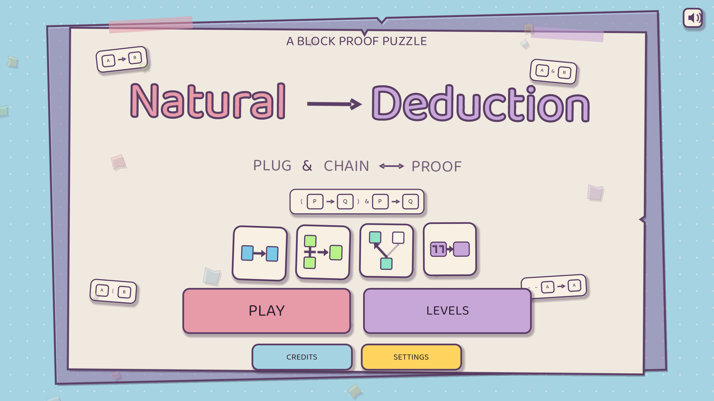

标题页把游戏的四个核心动作做成可点击、可随机切换的规则卡；同时提供 Levels、Credits 和 Settings。

### 2.2 章节与关卡

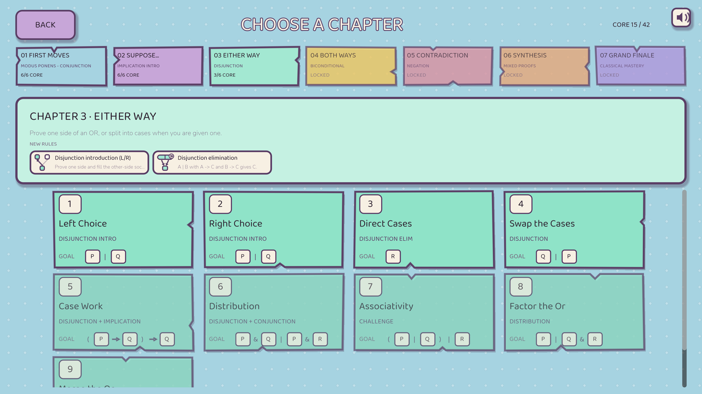

章节按顺序解锁。每章前 6 个核心关决定下一章是否开放；第 7/8/9 关是可选挑战关，按普通编号显示，不影响章节 gate。

### 2.3 证明树

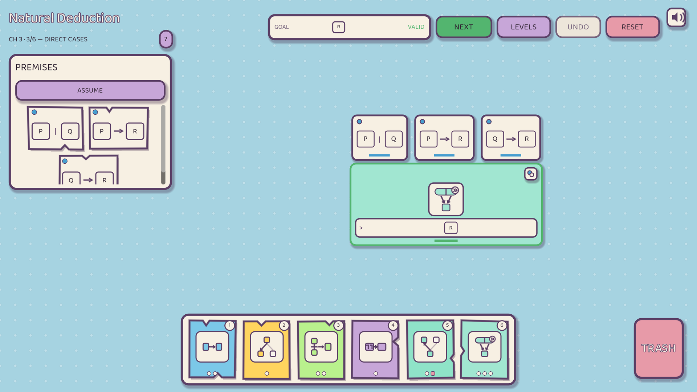

玩家把真实的 `RuleBlock` 和 `FormulaBlock` 拼成证明树。每张规则卡在输入变化后递归刷新，显示当前结果公式和合法性状态。

### 2.4 假设浮窗与嵌套作用域

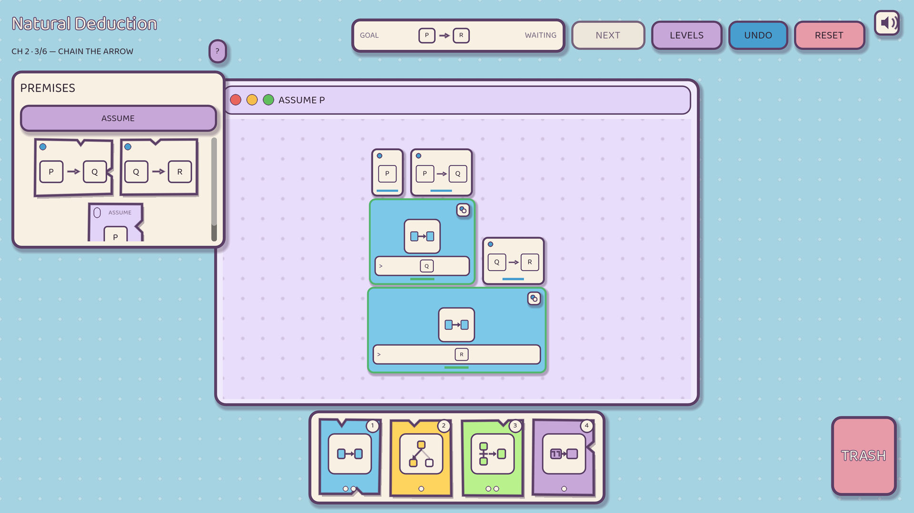

ASSUME 打开一个独立无限画布。浮窗可以嵌套，父窗口会裁剪子窗口；关闭浮窗后留下 `A -> B` 标记，可以继续拖入其他规则。

### 2.5 Formula Builder

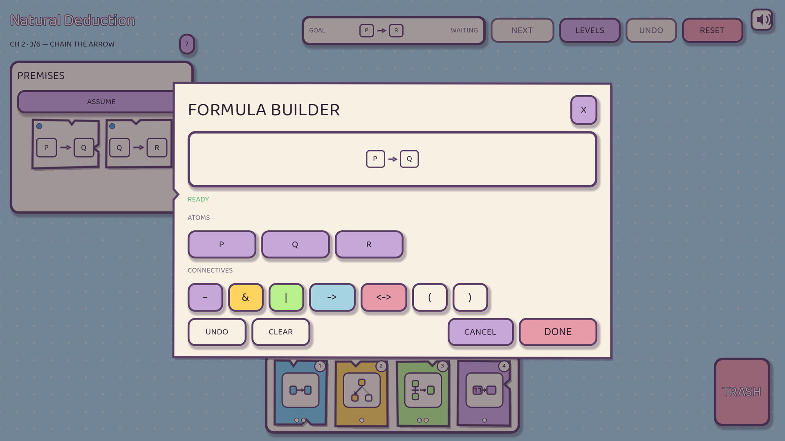

公式构建器支持点击 atom/连接词，也支持直接键盘输入；预览使用同一套解析器实时检查。Web 上字体缺少 Unicode 箭头时，会使用 ASCII `->` / `<->`，公式卡上的箭头由自定义绘制组件完成。

### 2.6 章节规则介绍

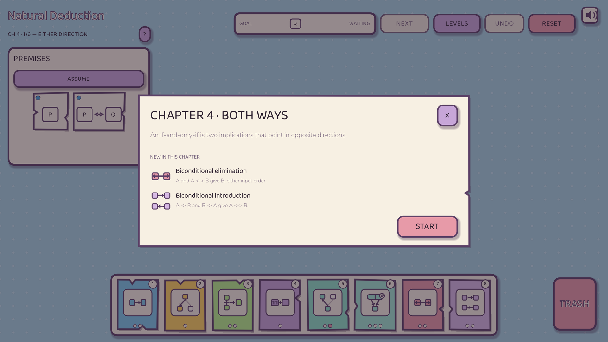

第一次进入章节时显示新规则介绍卡；`?` 按钮可重复打开。未解锁的规则不会出现在底部规则架。

### 2.7 发布与玩家反馈

游戏在 **P\&KU 谜题协会** 发布后收获了热烈讨论和试玩。itch.io 上线首日获得 **92 views / 50 browser plays**，第二天达到 **152 views / 94 browser plays**。

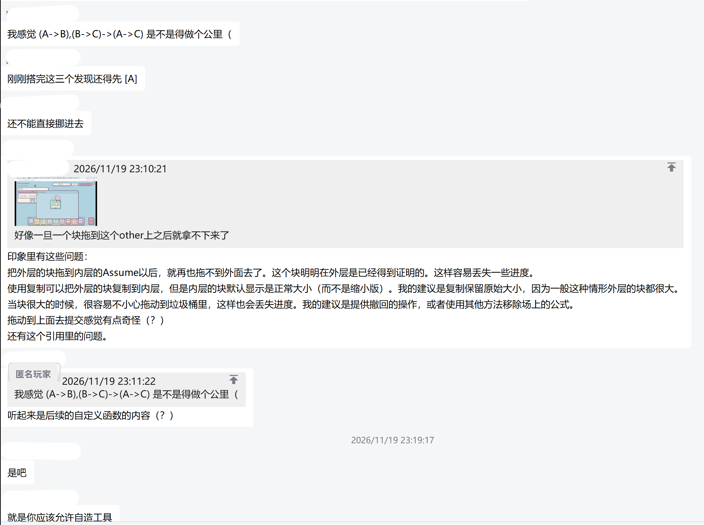

截图展示了一些真实试玩反馈，包括跨作用域拖拽、复制块的大小、误拖入 TRASH、GOAL 提交方式和公式引用。其中跨作用域拖拽、误删后的 Undo、公式引用显示等问题已经转化为实现和回归测试；其余建议保留为后续改进。

真诚感谢所有试玩玩家以及他们提出的宝贵意见。游戏仍在积极开发中；本文档描述的功能、关卡和截图可能与持续更新的实际仓库存在差异，**请以实际仓库和最新提交为准**。

## 3. 术语表

后面会反复提到一些界面和数据结构名称。这里先用游戏画面把它们对应起来，读代码时就不容易迷路。

### 3.1 界面上的卡片

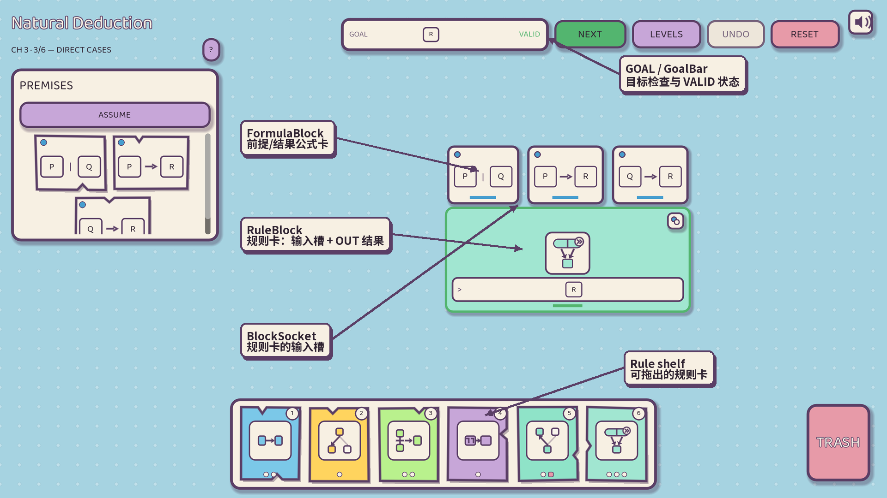

| 术语 | 在本项目中的含义 |
|---|---|
| **FormulaBlock** | 一张公式卡，放前提或已经推导出的公式，例如 `P`、`P -> Q`。 |
| **RuleBlock** | 一张规则卡，接收一个或多个输入槽，按规则产生 OUT 公式，例如 implication elimination。 |
| **BlockSocket** | 规则卡上的输入槽。把 FormulaBlock 或其他 RuleBlock 拖进去，就建立了证明边。 |
| **Premises** | 关卡给定的前提列表，也是可拖出的来源。 |
| **Rule shelf** | 底部规则架；当前章节可用的规则卡从这里拖出。 |
| **GOAL / GoalBar** | 右上角目标芯片；拖入证明根节点并检查整棵树。 |
| **Canvas** | 中央无限画布；可以平移、缩放、放置证明树。 |
| **TRASH** | 右下删除区；把块拖进去会连同子树删除。 |

### 3.2 Assume 窗口和作用域

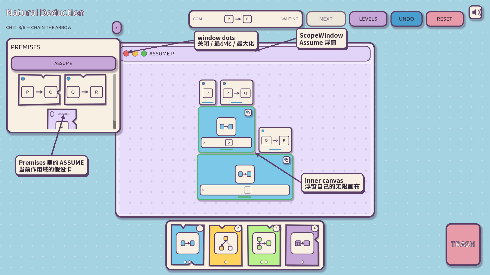

| 术语 | 含义 |
|---|---|
| **AssumptionBlock** | 紫色的假设叶子，例如“假设 P”。它是证明树里的一个叶子节点。 |
| **ScopeWindow** | ASSUME 打开的浮窗，拥有自己的无限画布；可以拖动、缩放、嵌套。 |
| **window dots** | 浮窗左上角的红/黄/绿圆点：关闭、最小化完成、最大化。 |
| **inner canvas** | 浮窗内部的独立 Canvas；它和外层画布共享逻辑上下文，但视觉上分开。 |
| **ScopeMarkerBlock** | 完成 Assume 后留在父画布上的标记，例如 `A -> B`；可以继续拖入其他规则。 |
| **active canvas** | 当前拥有输入的画布。打开 Assume 后，active canvas 是内层；但拖拽目标要用鼠标下的 CanvasView 判断，不能直接假设 active=target。 |

### 3.3 证明数据结构

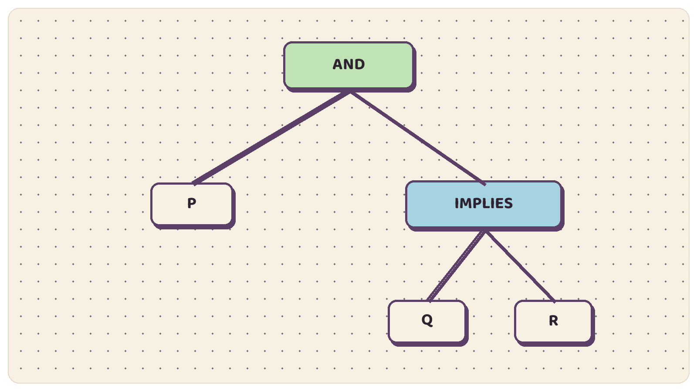

| 术语 | 含义 |
|---|---|
| **Formula AST** | 公式的语法树。`AND`、`IMPLIES` 是内部节点，`P/Q/R` 是叶子；括号会改变树形。 |
| **ProofTree** | 由证明节点和输入边组成的有向图；每个节点记录公式、规则和 context。 |
| **Context** | 当前证明仍然依赖的 assumption id 集合。根 context 为空才表示证明闭合。 |
| **ProofAdapter** | 把 UI 的 FormulaBlock / RuleBlock / ScopeMarkerBlock 翻译成 ProofTree 节点的编译器。 |
| **Rule derivation** | 给规则和输入公式，计算它应该产生的结论；验证会重新执行一次。 |

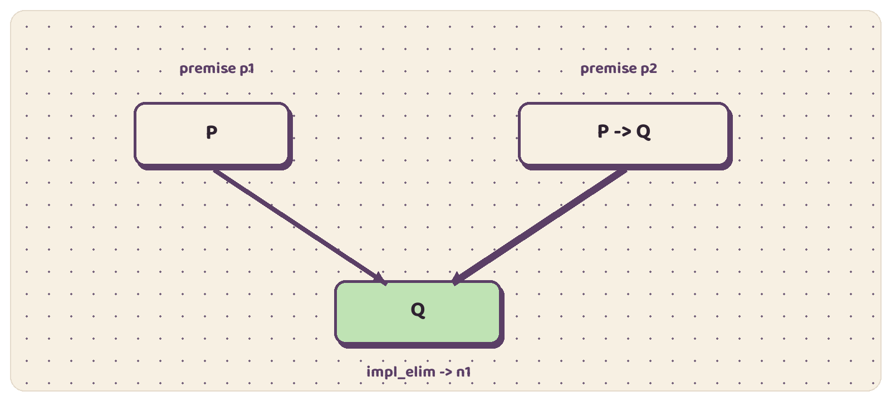

### 3.4 课程与状态术语

| 术语 | 含义 |
|---|---|
| **Chapter** | 一组按规则增量组织的主线关卡；前 6 个核心关决定下一章解锁。 |
| **Level / Stage** | 一个具体的前提 + 目标证明任务。 |
| **Optional / Challenge** | 每章第 7/8/9 关，正常编号但不影响下一章 gate。 |
| **Rule intro** | 第一次进入章节时显示的规则介绍卡；`?` 可重复打开。 |
| **Undo snapshot** | 操作前对已打开画布根块的深拷贝；用于恢复上一步。 |
| **Side switch** | L/R 或 E/I 切换；本项目只保留 L/R，double negation 不再提供直接 ~~I 卡。 |

术语对应之后，第 4 章会按“公式 AST -> 证明检查 -> UI 交互”的技术层次展开。

## 4. 课程知识与核心设计

### 4.1 公式 AST 与解析

#### 4.1.1 公式的数据结构
`logic/formula.gd` 使用不可变的 tagged union 表示公式：

```text
ATOM, NOT, AND, OR, IMPLIES, IFF
```

每个节点保存 `kind`、`atom_name`、`left`、`right`。选择这种表示的原因是：

- 公式是递归结构，适合用递归下降解析和递归规则推导；
- 不可变节点避免 UI 修改过程中出现共享状态；
- `equals()`、`to_string()`、`_render()` 可以集中实现；
- 逻辑层不依赖场景树，CLI 和 UI 共用同一套语义。

#### 4.1.2 递归下降解析器
`logic/formula_parser.gd` 是手写递归下降解析器，优先级从高到低：

```text
~  >  &  >  |  >  ->  >  <->
```

其中 `->`、`<->` 右结合。解析器输出带错误位置的 `ParseResult`，Formula Builder 的实时预览和 CLI 使用同一个入口，避免“UI 能输入但 CLI 不能解析”的分叉。

#### 4.1.3 AST 的编译与编辑

UI 侧的 `RuleBlock` / `FormulaBlock` 不直接实现逻辑，它们只是可拖拽的视图。编译过程发生在 `ProofAdapter`：

```text
FormulaBlock       -> premise-like node
AssumptionBlock    -> assume node（按 group 去重）
RuleBlock          -> apply_rule(rule_id, input_node_ids, extra)
ScopedRuleBlock    -> apply_scoped(rule_id, proof_ids, assumption_ids)
ScopeMarkerBlock   -> impl_intro（作用域生成的结论）
```

其中 `AssumptionBlock` 通过 group 去重：同一个假设可以被多个分支共享，但在证明图中只对应一个 assume 节点。这也是 `<->I`、`or-E` 能正确表达“同一假设被多个分支使用”的关键。

#### 编辑过程中的结构约束

块可以被拖拽、复制、删除、放进 socket、从 socket 拉出。每次编辑后：

1. 规则卡调用 `refresh()`，自底向上重算 OUT 公式和状态；
2. `main.refresh_machine()` 刷新所有画布和目标；
3. 验证只在最终提交 GOAL 时执行，避免拖拽过程中频繁做全树验证；
4. 复制使用 `duplicate_block()` 深拷贝整棵输入子树；
5. Undo 使用画布快照深拷贝根块，而不是记录一个难以反向的 UI 命令日志。

#### 防循环

socket 在接收块之前会检查：

- 目标块不能是当前拖拽块的祖先；
- 块不能进入自己的子树；
- 规则卡状态必须完整。

这样保证 UI 块图仍然是一棵有向无环图，而不是自引用结构。

#### 4.1.4 AST 检查入门：以第一关为例
这一节尽量不使用复杂术语；即使没有学过数据结构，也可以把它看成“把一句话拆成一棵家族树”。

#### 先说三个词

- **节点**：树上的一个圆圈，例如公式 `P`、`P -> Q` 或 `&`。
- **子节点**：一个公式直接包含的下一层公式。
- **递归**：先检查当前节点，再用同样的方法检查每个子节点。

公式 AST 不是字符串，而是一棵嵌套的对象树。例如：


`AND` 和 `IMPLIES` 是内部节点，`P/Q/R` 是叶子节点。括号不是装饰；它改变了树的结构。

下面的两个公式含相同的字母，但 AST 不同：

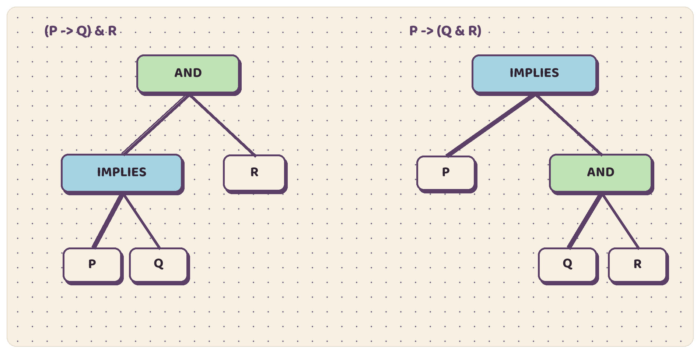

所以程序不能简单比较字符串。`Formula.equals()` 会同时比较两棵树的形状：

```text
equals(a, b):
    if one is missing: false
    if a.kind != b.kind: false
    if a is an atom: compare atom names
    return equals(a.left, b.left) and equals(a.right, b.right)
```

如果叶子数量不同，或者某个节点从 `IMPLIES` 换成 `AND`，比较就会失败。项目还用一个 round-trip 测试保证：

```text
text -> parse -> AST -> to_string() -> parse -> same AST
```

#### 一个完整的关卡例子

第一关：

```text
premises: P, P -> Q
goal:     Q
```

两个前提在游戏里的实际公式卡：

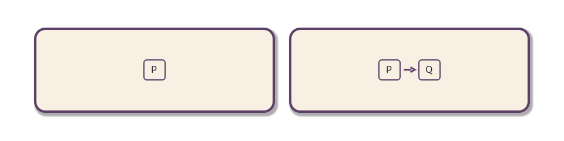

在 AST 中，`P` 是一个叶子，`P -> Q` 是一个 `IMPLIES` 节点。

玩家把前提拖进 `impl_elim` 规则卡。规则卡不是“写死输出 Q”的；它只记录两个输入槽：

```text
impl_elim:
  input 0: P
  input 1: P -> Q
```

`ProofAdapter` 把 UI 编译成证明节点：


#### 证明检查器怎样检查

检查器从根节点 `n1` 开始：

```text
validate(n1, goal = Q):

1. 检查根公式
   n1.formula = Q
   goal       = Q
   相等 -> 继续

2. 检查根 context
   n1.context = {}
   目标要求 closed proof -> 继续

3. 重新执行 n1 的规则
   取出 n1 的两个子节点公式：
       P
       P -> Q
   调用 RulesRes.derive("impl_elim", [P, P->Q])
   得到 Q

4. 比较
   derive 得到的 Q == 节点记录的 Q -> 继续

5. 检查子节点
   p1、p2 都是 premise，没有未解除假设 -> 通过
```

这里的关键不是“看起来像”，而是：

- 节点记录的公式必须和重新推导的公式完全相同；
- 根节点的 context 必须为空；
- 每个子节点也要通过同样的检查。

#### 一个故意写错的例子

假设目标是 `Q`，但玩家把 `P -> Q` 这张卡错放成了 `P & Q`：

```text
        n1
       /  \
      P   P & Q
```

检查器重新执行：

```text
derive("impl_elim", [P, P & Q])
```

规则看到第二个输入的 `kind` 是 `AND`，不是 `IMPLIES`，于是返回错误。即使两个字母都包含 P 和 Q，也不能通过，因为 AST 的节点种类不同。

另一种错误是：

```text
premises: P, P -> Q
goal:     R
```

根节点记录的是 `Q`，`Q != R`，验证在第一步就失败。

#### 为什么还需要 context

看这个证明：

```text
       [P]       <- assumption
        |
        P        <- proof
        |
      P -> P     <- close Assume
```

根节点的 AST 是 `P -> P`，context 是空集。但如果在 Assume 里只拿出一个 `P`，它的 AST 也是 `P`，context 却包含“当前假设 P”：

```text
P        formula = P
context  = {a1}
```

如果把它当作整个证明的根，目标 `P -> P` 的检查会失败，因为根 context 不为空。也就是说：

> AST 检查“公式长得对不对”，context 检查“这个公式有没有借用还没解除的假设”。

这两层必须同时存在。第一关的 `Q` 不涉及假设，所以 context 是空的；到了第二章的 `P -> P`，就必须先关闭 Assume，生成一个 context 为空的 `impl_intro` 节点。

#### 这和 UI 的跨作用域 bug 有什么关系

曾经玩家可以把内层 Assume 的 `P` 拖到外层。光看 AST，它是合法的 `P`；真正的问题是它依赖了内层的 assumption group。因此 UI 在放置前检查：

```text
block.free_assumptions 里的每个 group
必须出现在目标 canvas 的 context groups 里
```

即使 UI 漏掉，最终`ProofTree.validate(require_closed=true)`也会因为 context 不为空而拒绝。两道检查形成纵深防御。

#### 小结

- **AST** 是公式的语法树，回答“这个公式由什么组成”；
- **Rule derivation** 回答“给定这些输入，这条规则应该产出什么”；
- **ProofTree validation** 回答“整张证明图是否每一步都合法、是否依赖未解除的假设、是否等于目标”；
- **UI interaction** 回答“玩家有没有把一个合法公式拖到错误的上下文中”。

这四层分开以后，错误可以定位到具体层级，也便于写自动化测试。

### 4.2 证明检查器

#### 4.2.1 证明树与验证
`logic/proof_tree.gd` 将 UI 规则图转换成证明节点：

- premise：空上下文的输入公式；
- assume：带自身 assumption context 的假设节点；
- 普通规则：context 为所有输入 context 的并集；
- 作用域规则：显式记录 discharged assumption，并计算剩余 context。

验证过程不是只比较根公式，而是从根节点递归重新执行每个可达节点的规则推导，并检查：

- 未知规则或错误 arity；
- 环路和重复节点；
- 输入公式是否匹配；
- 作用域规则是否正确解除假设；
- 是否存在未解除的假设；
- 目标公式是否与根公式一致。

这一层与 UI 解耦，所以同一套证明既能由拖拽卡构造，也能由 `CliSession` 在无头环境中构造和验证。

#### 4.2.2 从块图到可验证的证明图
证明检查器不是“比较最后一张卡片的 OUT 公式”，而是把整个拖拽块图重新编译成 `ProofTree`，再从根节点递归重放规则。

#### 分层结构

```text
Formula AST / Parser
        │
        ▼
RulesRes.derive(rule_id, premises, extra_formula)
ScopedRulesRes.derive(rule_id, proofs, assumptions)
        │
        ▼
ProofTree：节点、context、discharged assumptions、goal
        │
        ▼
ProofAdapter：把 UI 的 RuleBlock / FormulaBlock / ScopeMarkerBlock 编译成节点
```

- `logic/rules.gd`：普通规则的纯函数推导；
- `logic/scoped_rules.gd`：作用域规则的公式形状检查和结论构造；
- `logic/proof_tree.gd`：证明图、上下文、作用域规则验证；
- `ui/proof_adapter.gd`：UI 块图到证明图的编译器。

#### ProofTree 的节点和上下文

每个节点保存：

```text
rule_id, formula, premise_ids, extra, discharged[]
```

`context` 是当前证明仍然依赖的 assumption id 集合：

- premise：空 context；
- assume：context 包含自身 id；
- 普通规则：合并所有输入节点的 context；
- `impl_intro`：从分支 context 中删除被解除的 assumption；
- `or_elim`：分别删除两个 case assumption，并拒绝 case 假设出现在另一个分支或 disjunction 中；
- `iff_intro`：拒绝跨分支使用；
- `not_intro` / `not_elim`：删除对应 assumption 后合并剩余 context。

验证时不是只检查根公式，而是：

```text
validate(root, goal):
    if root.formula != goal: fail
    if require_closed and root.context != {}: fail
    for node in reachable(root):
        if node in current_dfs_stack: fail（环）
        re-derive node from child formulas
        if derived_formula != node.formula: fail
        check context composition
        check discharged assumption legality
```

这保证：

- 输入公式与规则要求的形状一致；
- 规则应用产生的公式和节点记录的公式一致；
- 证明没有未解除的假设；
- 作用域规则没有错误解除或跨分支偷用假设；
- 目标与根结论一致。

#### 复杂度

设证明图有 V 个节点、E 条输入边，公式平均大小为 F：

```text
验证时间：O(V + E · F)
验证空间：O(V + E)
```

对于本项目 61 个关卡，单次验证规模很小；显式重推导换来的是可以准确定位到错误节点，而不是只给一个“目标不匹配”。

#### 已修复的逻辑漏洞

| 漏洞 | 根因 | 修复 |
|---|---|---|
| 把外层块拖进 Assume 后无法再拖出 | 放置逻辑只看“当前激活 canvas”，没有看鼠标下的目标 canvas | `_drop_view_at()` 找到鼠标下真正的 CanvasView；记录 `_origin_canvas`；socket 只在目标 canvas 搜索 |
| 把依赖 Assume 假设的块拖到外层或 GOAL | 只检查“是否同一个 canvas”，没有检查自由假设 context | `_context_groups_for_canvas()` 沿 parent_record 链收集可见 group；`_block_dependencies_ok()` 要求所有自由假设都在目标 context 中 |
| 把 ScopeMarker 拖进自己的窗口造成无限递归 | Marker 持有 `window_record`，没有检查目标窗口是否属于自己 | 从目标记录沿 `parent_record` 链检查是否包含 marker 的 window；命中就拒绝 |
| 拖拽快照复制规则卡时重复播放正确音效 | `duplicate_block()` 创建副本并刷新为 VALID，触发 `rule_valid` | 快照捕获期间设置 `_suppress_rule_feedback`；Undo 恢复期间同时设置 `_undo_restoring` |
| 新建 Assume 后无法 Undo | 打开窗口时直接清空历史，没有压入 scope-open 动作 | 压入 `{"kind":"scope_open","record":...}`；Undo 关闭最新窗口并恢复父 canvas |
| 嵌套全屏时子窗口被子 canvas 盖住 | desktop layer 的绘制层级低于 inner view | desktop layer 独立 z-index；`desktop_layer.resized` 后递归重排子窗口 |
| 长目标公式把 4 列关卡卡拉宽 | FormulaVisual 的最小宽度被 GridContainer 传播 | 用固定最小宽度的 Control 包装 FormulaVisual，按可用宽度缩放，不让卡片撑开网格 |

这些修复都有对应的无头回归测试，例如 `run_ui_scoped` 的跨作用域拖拽、依赖拒绝、ScopeMarker 递归拒绝，以及 `run_ui_model` 的音效反馈测试。

### 4.3 UI 交互与编辑

#### 4.3.1 UI 与逻辑分离
工程刻意把公式、规则、验证、CLI 放在 `logic/` 和 `cli/`，把场景、拖拽、卡片绘制放在 `ui/`：

- 逻辑层全部使用 `RefCounted`，不依赖场景树；
- 无头测试可以在没有窗口的情况下验证完整证明；
- UI 只负责收集输入、显示状态、播放音效和动画；
- 规则错误由验证层给出，UI 不重复实现逻辑。


#### 4.3.2 UI 交互中的逻辑判断
#### 拖拽目标不是“当前 canvas”

游戏中最容易写错的一点是：

```text
active canvas != canvas under mouse
```

Assume 打开后，`main.canvas` 指向最内层作用域；但鼠标可能在外层背景上。正确做法是：

```text
hovered Control
  -> 向上找第一个 CanvasView
  -> 该 view.world 才是目标 canvas
```

拖拽 origin 也要记录在块原来所在的 canvas 上，而不是当前 active canvas。否则会出现“外层块拖出去后找不到家”的问题。

#### 跨作用域依赖判定

每个作用域记录自己的 assumption group。目标 canvas 的可见假设集合：

```text
target context groups =
    target scope.group
    + all ancestor scope groups
```

块允许离开当前作用域，当且仅当：

```text
for every assumption in block.get_free_assumptions():
    assumption.group in target context groups
```

因此：

- `P -> Q` 不依赖当前 Assume，可以带走；
- 依赖当前 Assume 的 `Q` 不能带到外层；
- 已解除的 `A -> B` marker 的自由假设不含自己的 group，可以带走；
- GOAL 位于 base context，空 context 不允许任何未解除假设通过。

这就是“Want to cheat huh, no way.”和“Infinite recurrsion huh, no way.”背后的实际检查，而不是只在 UI 上隐藏按钮。

#### Undo 的交互状态

Undo 需要同时处理三类状态：

1. **画布内容**：base + 所有打开的 scope inner canvas 的根块、位置和 GOAL 链接；
2. **作用域动作**：新建 Assume 压入 scope-open 记录，Undo 关闭窗口；
3. **反馈副作用**：复制快照会把规则副本变成 VALID，必须抑制 `rule_valid`；Undo 恢复也要抑制反馈，避免“拆开再拼回”以外的操作重复响。

#### 交互边界案例

| 场景 | 预期 | 实现 |
|---|---|---|
| 把外层证明拖进 Assume | 允许，context 包含外层 | target canvas + context check |
| 把依赖 Assume 的结论拖到外层 | 拒绝 | context check + toast |
| 拖到自己的 Assume 窗口的 scope marker | 拒绝 | window_record 祖先链检查 |
| 拿起整份证明再放下 | 不播放新的验证音 | 快照复制期间抑制反馈 |
| 拆开输入再拼回 | 再次播放验证音 | 真实状态变化，不抑制 |
| Undo 恢复证明 | 不播放验证音 | `_undo_restoring` + suppress |
| 深层 Assume 最大化 | 后代窗口跟随 | desktop layer resized/递归 sync |
| 关闭所有深层窗口 | Premises 回到原位 | 连续 MAX 链测量 |

### 4.4 关卡、复杂度与工程取舍

#### 4.4.1 章节、进度与关卡数据
`ui/level_bank.gd` 以稳定 id 组织：

```text
chapter -> levels -> { premises, goal, teaches, optional }
```

`ui/progress_store.gd` 使用 `Dictionary` 记录完成状态和已看过的章节介绍：

- 章节通过前一章全部核心关解锁；
- 核心关顺序解锁；
- 可选关在核心关完成后一起开放；
- 可选关不参与下一章 gate；
- 进度写入 `user://progress.cfg`，退出后恢复。

#### 4.4.2 复杂度与工程取舍
| 部分 | 主要结构/算法 | 复杂度/取舍 |
|---|---|---|
| 公式解析 | 递归下降 | 与输入长度线性相关；比引入 parser generator 更小、更易调试 |
| 公式相等 | 递归结构比较 | 与公式大小线性相关；避免字符串比较带来的格式歧义 |
| 规则刷新 | 自底向上显式 `refresh()` | 每次输入变化只重算相关卡；没有长驻信号图 |
| 证明验证 | 图遍历 + 规则重新推导 | 与可达节点和规则输入数相关；会在每个节点检查 context |
| 拖拽 | 最近空槽 + 距离/面积排序 | 让落点符合直觉；避免 Spring 动画与逻辑判定耦合 |
| Undo | 画布快照 + 深拷贝 | 最多 40 步；换取实现简单和跨作用域恢复的一致性 |

### 4.5 这一部分的课程知识对应
- **数据结构**：不可变 AST、tagged union、证明 DAG、assumption context 集合、HashMap/Dictionary、作用域栈；
- **算法**：递归下降解析、递归验证/DFS、环检测、集合求并与差、拖拽目标搜索、快照与深拷贝；
- **复杂度**：解析 O(n)，验证 O(V + E·F)，关卡查询 O(L)，快照受 40 步上限约束；
- **工程**：逻辑/CLI/UI 分层、无头测试、错误可定位、AI 生成代码的审查和回归验证。

## 5. 安装与运行

### 环境

- Godot **4.7.2**（项目使用 `gl_compatibility`）
- Web 导出需要 4.7.2 Web export templates
- 无需数据库、外部服务或网络 API

### 桌面运行

```bash
godot --path .
```

或直接用 Godot 编辑器打开 `project.godot` 后运行。

### Web 导出

```bash
bash tools/export_web.sh
```

生成：

```text
build/web/
build/NaturalDeduction-web.zip
```

### 自动化测试

```bash
GODOT="D:/Godot/Godot_v4.7.2-stable_win64_console.exe"
PROJ="D:/Godot/Natural Deduction"

for t in run_cli_script run_scoped_cli run_book_examples run_stability \
         run_curriculum run_progress run_ui_model run_ui_scoped \
         run_chapter_ui run_shortcuts run_formula_builder run_audio_smoke run_title_idle; do
  "$GODOT" --headless --path "$PROJ" -s "res://tests/$t.gd" | tail -1
done
```

## 6. 测试与结果

### 6.1 课程验证

`tests/run_curriculum.gd` 对全部 **61 关**：

1. 用 CLI 建立前提和目标；
2. 执行 `tests/level_solutions.gd` 中的逐关证明脚本；
3. 验证证明树；
4. 检查使用的规则属于该章已解锁集合。

本次结果：

```text
Checked 61 levels across 7 chapters.
CURRICULUM RESULT: 1263 checks, 0 failed
```

### 6.2 自动化回归

| 套件 | 断言数 | 失败 |
|---|---:|---:|
| `run_cli_script`（7 个脚本） | 44 | 0 |
| `run_scoped_cli` | 23 | 0 |
| `run_book_examples`（17 题） | 17 | 0 |
| `run_stability` | 1177 | 0 |
| `run_curriculum` | 1263 | 0 |
| `run_progress` | 40 | 0 |
| `run_ui_model` | 103 | 0 |
| `run_ui_scoped` | 193 | 0 |
| `run_chapter_ui` | 43 | 0 |
| `run_shortcuts` | 35 | 0 |
| `run_formula_builder` | 22 | 0 |
| `run_audio_smoke` | 943 | 0 |
| `run_title_idle` | 44 | 0 |

### 6.3 边界与异常

测试覆盖了：

- 错误规则输入和 arity 不匹配；
- 循环证明图和重复节点；
- 未解除的假设、跨作用域错误使用；
- L/R 与 E/I 侧切换；
- 撤销后的目标链接恢复；
- 嵌套 Assume 的最大化和还原；
- 拖拽跨作用域后的依赖检查；
- 关卡解锁、可选关不参与 gate；
- 章节页 7 个 tab、9 张关卡卡的布局；
- Web 字体缺字导致的 ASCII 公式回退。

### 6.4 手工验证

- 在桌面版完成一关并观察 NEXT / NEXT CHAPTER 按钮；
- 打开两个嵌套 Assume 窗口并验证最大化链；
- 在 Web 版验证 Level 页面、拖拽和公式显示；
- 用无痕窗口检查 Web 缓存更新。

## 7. 已知局限与改进

- 当前实现的是**命题逻辑**，尚未支持一阶量词 `forall/exists` 与 identity；NDpack 的谓词题暂未进入游戏。
- Web 端没有鼠标滚轮/右键，触屏缩放和平移仍需补充。
- 公式卡目前以树形布局为主，超大证明仍可能让画布拥挤。
- 某些长目标在关卡卡上会缩放显示，完整内容需要 tooltip。
- 无头 UI 测试退出时仍会打印 Godot RID/ObjectDB 警告，但断言结果不受影响。

后续计划：

1. 一阶谓词逻辑的 AST、替换、量词规则和词项选择 UI；
2. 更强的移动端手势与响应式布局；
3. 更多来自 NDpack 的谓词/identity 综合题；
4. 证明导出（文本/图片）和更细的步骤回放。

## 8. 外部资源、引用与 AI 使用声明

### 外部资源

- 引擎：Godot 4.7.2；
- 字体：Baloo 2、Nunito、Patrick Hand，SIL Open Font License；
- 音效：Kenney Casino Audio / Interface Sounds、VSCO2 CE（CC0）；
- 键盘音：eklee / qubodup “Single Key Press Sounds”（CC-BY 3.0）；
- BGM：项目原创合成曲目；
- 习题参考：Alastair Carr, *The Natural Deduction Pack*（项目内 `NDpack.pdf`）；新增关卡来自其命题逻辑部分 4.1–4.6。

### AI 使用声明

```text
使用工具：Claude Code（AI coding agent）
参与环节：需求拆解、架构讨论、Godot/GDScript 实现、测试编写、
          Web 导出与文档整理。
本人完成的设计、修改与判断：
  - 定义项目目标、关卡范围和交互预期；
  - 审查拖拽、作用域、Undo、进度和 Web 行为；
  - 运行测试、检查失败案例并确认最终版本；
  - 对生成的实现进行取舍和验收。
验证方法及结果：
  - 13 个无头测试套件全部通过；
  - 61 个关卡通过 CLI 解法和规则白名单验证；
  - 实际桌面/Web 手工检查关键交互与截图。
代表性协作案例：
  - 跨作用域拖拽的 origin/target 判定；
  - Undo 快照与规则音效重复问题的定位；
  - 嵌套 Assume 的 z-order 和默认布局路径统一。
引用与复用的外部资源：见上节。
```

> 姓名、学号、院系和 GitHub 链接已填写；AI 使用声明请根据实际参与情况确认或调整。

## 9. 评分点对应

| 评分维度 | 本项目对应内容 |
|---|---|
| 核心功能与验证 | 完整可运行的拖拽证明流程；61 关 CLI 验证；13 组回归测试 |
| 课程知识与理解 | AST、递归下降解析、图遍历验证、作用域 context、进度图、Undo 快照 |
| 代码质量 | `logic/`、`cli/`、`ui/` 分层；显式 refresh；无头可测 |
| 文档与工程交付 | README、运行命令、Web 导出、截图、测试结果、引用声明 |
| 创新与实用价值 | 把自然演绎证明变成可拖拽、可撤销、可即时验证的学习工具 |
